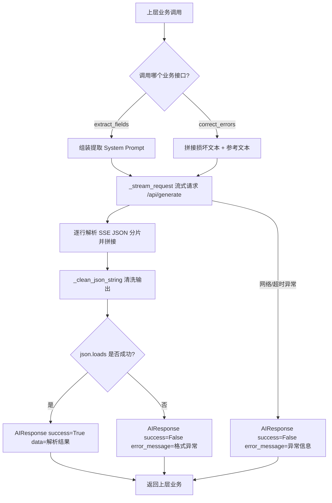

# OllamaClient 模块详细设计说明书

| 文档属性 | 内容 |
| --- | --- |
| 模块名称 | OllamaClient（本地大模型客户端模块） |
| 版本 | V1.0 |
| 编写日期 | 2026-10-24 |
| 适用项目 | 医疗儿童健康档案系统（DNA 文本纠错 / 档案信息提取） |

---

## 1. 引言

### 1.1 编写目的

本文档详细描述 `OllamaClient` 模块的内部设计，包括数据结构、类设计、方法实现逻辑、接口定义、异常处理与错误码，为开发、测试及后续维护提供依据。

### 1.2 模块定位

本模块是系统与本地 Ollama 推理服务之间的**唯一通信层**，向上层业务提供两类 AI 能力：

1. **医疗档案字段提取**（`extract_fields`）：从非结构化档案文本中提取结构化 JSON 信息。
2. **DNA 解码文本纠错**（`correct_errors`）：对比参考文本，修复 DNA 序列解码产生的错字/乱码。

### 1.3 设计约束

- 仅使用 Python 标准库（`json`、`urllib`、`time`、`re`、`dataclasses`、`typing`），**无第三方依赖**，便于在无外网环境下部署。
- 通过 HTTP 与本地 Ollama 服务（默认 `http://localhost:11434`）交互。
- 所有 AI 输出均为流式（`stream: true`），便于向前端上报进度。
- 输出严格限定为 JSON，模块内负责 JSON 清洗与解析。

---

## 2. 总体设计

### 2.1 模块结构

```
OllamaClient 模块
├── AIResponse（数据类）        —— 统一返回载体
└── OllamaClient（服务类）
    ├── __init__                —— 初始化连接参数
    ├── test_connection         —— 服务与模型可用性探测
    ├── extract_fields          —— 医疗档案字段提取（业务接口）
    ├── correct_errors          —— DNA 文本纠错（业务接口）
    ├── _stream_request         —— 流式请求私有方法（通信层）
    └── _clean_json_string      —— JSON 清洗私有方法（解析层）
```

### 2.2 依赖关系

| 依赖项 | 类型 | 说明 |
| --- | --- | --- |
| Ollama 服务 `/api/tags` | 外部服务 | 模型列表查询（连接探测） |
| Ollama 服务 `/api/generate` | 外部服务 | 文本生成（流式） |
| 上层业务回调 `on_progress(progress:int, message:str)` | 内部接口 | 进度上报，可选 |

### 2.3 总体调用流程



---

## 3. 数据结构设计

### 3.1 `AIResponse`（dataclass）

所有业务方法的统一返回结构：

| 字段 | 类型 | 必填 | 说明 |
| --- | --- | --- | --- |
| `success` | `bool` | 是 | 调用是否成功 |
| `data` | `Optional[Any]` | 否 | 成功时为解析后的 JSON 对象（dict） |
| `error_message` | `str` | 是 | 失败原因描述，成功时为空串 |
| `tokens_used` | `int` | 是 | 预留字段，当前版本固定为 0 |
| `duration_seconds` | `float` | 是 | 本次调用总耗时（秒），含请求与解析 |

### 3.2 Ollama 请求体（`/api/generate`）

```json
{
  "model": "modelscope.cn/Qwen/Qwen2.5-Coder-7B-Instruct-GGUF:latest",
  "prompt": "<用户提示词/文档原文>",
  "system": "<系统提示词>",
  "stream": true,
  "options": {
    "temperature": 0.1,
    "num_predict": 2048
  }
}
```

| 参数 | 取值 | 设计理由 |
| --- | --- | --- |
| `temperature` | 0.1 | 信息提取/纠错属确定性任务，低温降低幻觉与随机改写 |
| `num_predict` | 2048 | 限制输出长度，防止失控生成 |
| `stream` | true | 支持进度回调，避免长任务无响应 |

### 3.3 提取结果 JSON Schema（`extract_fields` 的 `data`）

```json
{
  "物理存储": {
    "姓名": "", "性别": "", "出生日期": "", "证件号码": "", "户籍地址": "",
    "常住地址": "", "建档机构": "", "建档日期": "", "联系电话": "",
    "民族": "", "ABO血型": "", "Rh血型": "", "父亲姓名": "", "父亲电话": "",
    "母亲姓名": "", "母亲电话": "", "出生孕周": "", "出生体重": "", "出生身长": "",
    "分娩机构": "", "Apgar(1min)": "", "Apgar(5min)": "", "档案编号": ""
  },
  "反复存储": [
    { "随访日期": "", "当前体重": "", "体温": "" }
  ],
  "病症记录": {
    "苯丙酮尿症": "", "先天性甲状腺功能减低症": "", "听力筛查": "",
    "过敏史": "", "先天异常": "", "既往住院史": "", "家族遗传病史": ""
  }
}
```

约束规则：

1. `性别` 仅允许 `男` / `女`，缺失为 `""`。
2. 单值字段缺失时一律为空字符串 `""`，**禁止编造**。
3. `反复存储` 为数组，多条随访记录全部提取；无记录时为 `[]`。

### 3.4 纠错结果 JSON Schema（`correct_errors` 的 `data`）

```json
{
  "corrected_text": "修复后的完整文本",
  "corrections": [
    { "position": 12, "original": "错字", "corrected": "对字", "reason": "根据上下文推断" }
  ],
  "confidence": 0.95
}
```

纠错原则：

1. 优先参考已知正确文本。
2. 不确定字符保留原文并在 `corrections` 中标注。
3. 损坏严重无法修复时 `confidence < 0.5` 且保留原文。

---

## 4. 类与方法详细设计

### 4.1 `OllamaClient.__init__`

**签名**：`__init__(self, base_url, model_name, timeout, max_retries)`

| 参数 | 默认值 | 说明 |
| --- | --- | --- |
| `base_url` | `http://localhost:11434` | Ollama 服务地址，末尾 `/` 自动去除 |
| `model_name` | `modelscope.cn/Qwen/Qwen2.5-Coder-7B-Instruct-GGUF:latest` | 推理模型标识 |
| `timeout` | 300 | 生成请求超时（秒），大模型推理耗时长故取较大值 |
| `max_retries` | 2 | 最大重试次数（**预留字段，当前版本未使用**） |

无返回值；构造过程不发起网络请求。

### 4.2 `test_connection`

**签名**：`test_connection(self) -> Tuple[bool, str]`

**处理逻辑**：

1. `GET {base_url}/api/tags`，超时固定 5 秒（快速失败）。
2. 状态码 200 → 解析 `models` 数组，提取模型名列表。
3. 判断是否存在名称包含 `Qwen2.5` 的模型：
   - 存在 → `(True, "Ollama服务正常，模型已就绪")`
   - 不存在 → `(False, "Ollama服务正常，但未找到相关Qwen模型，请先执行 ollama pull")`
4. 非 200 → `(False, "服务响应异常，状态码: X")`
5. 任何异常（连接拒绝、超时等）→ `(False, "无法连接Ollama服务，请确认服务已启动: <异常信息>")`

> 建议上层在启动时调用一次，作为前置健康检查。

### 4.3 `_stream_request`（私有）

**签名**：`_stream_request(self, request_body: dict, on_progress: Callable = None, stage_message: str = "AI正在思考...") -> str`

**处理逻辑**：

1. `POST {base_url}/api/generate`，请求体 JSON 序列化，`Content-Type: application/json`，超时取 `self.timeout`。
2. 逐行读取响应流，每行是一个 JSON 分片对象；累加分片的 `response` 字段到 `full_response`。
3. 进度上报策略：每累计 **5 个分片** 回调一次；进度值采用伪进度公式 `min(30 + chunk_count // 10, 80)`，即从 30% 起步、缓慢爬升、封顶 80%（90%/100% 由调用方在解析阶段上报）。
4. 收到 `done == true` 的分片后 `break` 结束读取。
5. 异常不做内部捕获，**直接向上抛出**，由业务方法统一包装为 `AIResponse`。

**返回**：完整的模型原始输出文本。

### 4.4 `_clean_json_string`（私有）

**签名**：`_clean_json_string(self, raw_text: str) -> str`

**处理逻辑**：

1. 先尝试直接 `json.loads`，成功则原样返回（快路径）。
2. 失败则用正则 `\{.*\}`（`re.DOTALL`，贪婪匹配）截取**第一个 `{` 到最后一个 `}`** 之间的内容——用于剥离模型可能夹带的说明文字或 Markdown 标记。
3. 仍无匹配则返回原文（后续解析必然失败，进入 `JSONDecodeError` 分支）。

> 说明：贪婪匹配 `.*` 可正确处理嵌套大括号；但若文本中混有多个独立 JSON 对象会被合并截取，当前场景（单对象输出）可接受。

### 4.5 `extract_fields`

**签名**：`extract_fields(self, document_text: str, on_progress: Callable = None) -> AIResponse`

**输入**：`document_text` 为档案原始文本；`on_progress(progress:int, message:str)` 为可选进度回调。

**处理流程**：

| 步骤 | 进度 | 动作 |
| --- | --- | --- |
| 1 | 10% | 组装系统提示词（含输出 JSON 模板与三条约束规则） |
| 2 | 20% | 构造请求体，调用 `_stream_request`（阶段提示"AI正在识别字段..."） |
| 3 | 90% | `_clean_json_string` 清洗 + `json.loads` 解析 |
| 4 | 100% | 返回 `AIResponse(success=True, data=parsed, duration_seconds=耗时)` |

**失败分支**：

- `JSONDecodeError` → `AIResponse(success=False, error_message="AI返回格式异常，不是合法JSON")`
- 其他异常（网络、超时等）→ `AIResponse(success=False, error_message=str(e))`

两种失败均返回 `duration_seconds`，便于性能统计。

**系统提示词要点**：角色设定（医疗档案信息提取助手）、输出格式模板（见 3.3）、禁止 Markdown 代码块包裹、缺失字段留空不编造、性别枚举限制、多条随访全部入数组。

### 4.6 `correct_errors`

**签名**：`correct_errors(self, corrupted_text: str, reference_texts: List[str], on_progress: Callable = None) -> AIResponse`

**输入**：

| 参数 | 说明 |
| --- | --- |
| `corrupted_text` | DNA 序列解码得到的疑似损坏文本 |
| `reference_texts` | 已知正确的参考文本列表，多个文本以 `\n---\n` 拼接；为空时传 `"无参考文本"` |

**处理流程**：与 `extract_fields` 同构——组装纠错提示词 → 流式请求（阶段提示"AI正在进行纠错推理..."）→ 清洗解析 → 返回 `AIResponse`。进度节点与失败分支完全一致。

**系统提示词要点**：角色设定（DNA 解码医疗文本纠错专家）、输出格式模板（见 3.4，注意模板内 `{{}}` 为 f-string 转义）、三条修复原则（优先参考、不过度修改、低置信保留原文）。

**用户提示词结构**：`【损坏文本】` + 原文，`【参考文本】` + 参考内容，段间以分隔线区分。

---

## 5. 接口汇总表

| 方法 | 可见性 | 输入 | 输出 | 副作用 |
| --- | --- | --- | --- | --- |
| `__init__` | public | 4 个可选配置参数 | — | 初始化实例属性 |
| `test_connection` | public | 无 | `Tuple[bool, str]` | 1 次 HTTP GET |
| `extract_fields` | public | 文档文本、进度回调 | `AIResponse` | 1 次流式 HTTP POST |
| `correct_errors` | public | 损坏文本、参考文本列表、进度回调 | `AIResponse` | 1 次流式 HTTP POST |
| `_stream_request` | private | 请求体、回调、阶段文案 | `str`（原始输出） | 流式读取 |
| `_clean_json_string` | private | 原始文本 | `str`（清洗后） | 无 |

---

## 6. 异常处理设计

| 场景 | 触发位置 | 处理方式 | 用户可见信息 |
| --- | --- | --- | --- |
| Ollama 未启动 | `test_connection` / `_stream_request` | 捕获并包装 | "无法连接Ollama服务，请确认服务已启动: …" |
| 模型未拉取 | `test_connection` | 返回 `(False, …)` | "…请先执行 ollama pull" |
| 请求超时 | `_stream_request`（默认 300s） | 异常上抛→业务层包装 | 异常字符串（含 timeout 语义） |
| 输出非 JSON | `extract_fields` / `correct_errors` | `JSONDecodeError` 分支 | "AI返回格式异常，不是合法JSON" |
| 其他未知异常 | 任意 | 兜底 `except Exception` | `str(e)` |

设计特点：

- **业务方法永不向外抛异常**，统一以 `AIResponse` 承载成败，降低上层调用复杂度。
- `_stream_request` 不吞异常，保证错误信息完整上浮。
- 回调 `on_progress` 内部若抛异常**不会被捕获**（当前设计），要求上层回调实现自身健壮性。

---

## 7. 进度回调协议

`on_progress(progress: int, message: str)` 约定：

| 进度区间 | 含义 | 上报方 |
| --- | --- | --- |
| 10% | 组装指令 | 业务方法 |
| 20% | 发送请求 | 业务方法 |
| 30%~80% | 流式接收中（伪进度，随分片数爬升） | `_stream_request` |
| 90% | 清洗解析 | 业务方法 |
| 100% | 完成 | 业务方法 |

> 伪进度说明：真实 token 总量未知，故按分片计数线性估算并封顶 80%，避免进度条长时间停滞。

---

## 8. 关键设计决策与已知限制

**设计决策**

1. **纯标准库实现**：零依赖，适合内网/离线部署的档案系统。
2. **低温生成（0.1）**：提取与纠错均为确定性任务，最大限度抑制模型"自由发挥"。
3. **提示词内置 JSON Schema**：以强格式模板 + "禁止 Markdown 包裹" 双重约束，配合 `_clean_json_string` 兜底清洗，保证结构化输出成功率。
4. **统一返回载体**：`AIResponse` 携带耗时，方便上层做性能监控与日志。

**已知限制（后续版本待办）**

1. `max_retries` 已定义但**未实现重试逻辑**，网络抖动场景需上层自行重试。
2. `tokens_used` 恒为 0，未从 Ollama 响应的 `eval_count` / `prompt_eval_count` 取值。
3. `_clean_json_string` 的贪婪正则无法处理"输出中包含多个独立 JSON 对象"的极端情况。
4. 模型名匹配逻辑硬编码为包含 `Qwen2.5` 子串，更换模型族时需同步修改 `test_connection`。
5. 未校验解析结果的字段完整性（如提取结果缺少"物理存储"键不会报错）。
6. 仅支持 `/api/generate`，未使用 `/api/chat` 接口（多轮对话场景受限）。

---

## 9. 测试要点

| 编号 | 测试项 | 方法 | 预期结果 |
| --- | --- | --- | --- |
| T01 | 服务未启动时探测 | 停止 Ollama 后调 `test_connection` | `(False, 包含"无法连接")` |
| T02 | 模型未拉取时探测 | 删除模型后调 `test_connection` | `(False, 提示 ollama pull)` |
| T03 | 正常提取 | 传入含完整字段的档案文本 | `success=True`，三类字段完整 |
| T04 | 缺失字段提取 | 传入信息残缺文本 | 缺失字段为 `""`，`反复存储` 可为 `[]` |
| T05 | 多条随访 | 传入多次随访记录文本 | 数组含全部记录 |
| T06 | 正常纠错 | 传入轻度损坏文本 + 正确参考 | `confidence ≥ 0.5`，`corrections` 定位准确 |
| T07 | 严重损坏纠错 | 传入严重乱码 | `confidence < 0.5`，保留原文 |
| T08 | 输出含 Markdown 包裹 | 模拟输出 ```` ```json … ``` ```` | 清洗后解析成功 |
| T09 | 输出完全非 JSON | 模拟输出自然语言 | `success=False`，错误信息为"格式异常" |
| T10 | 进度回调 | 传入回调收集调用序列 | 进度单调覆盖 10→20→30~80→90→100 |
| T11 | 耗时统计 | 记录 `duration_seconds` | 与实际耗时偏差 < 0.1s |

---

## 10. 使用示例

```python
client = OllamaClient()

# 1. 前置健康检查
ok, msg = client.test_connection()
if not ok:
    print(msg)
    return

# 2. 档案字段提取
def on_progress(p, m):
    print(f"[{p}%] {m}")

resp = client.extract_fields(document_text, on_progress=on_progress)
if resp.success:
    print("耗时:", resp.duration_seconds, "s")
    print("结果:", resp.data["物理存储"]["姓名"])
else:
    print("失败:", resp.error_message)

# 3. DNA 文本纠错
resp = client.correct_errors(
    corrupted_text="小明 3 岁 先天性甲状线功能减低症",
    reference_texts=["先天性甲状腺功能减低症"],
    on_progress=on_progress,
)
if resp.success:
    print("修复:", resp.data["corrected_text"])
    print("置信度:", resp.data["confidence"])
```
