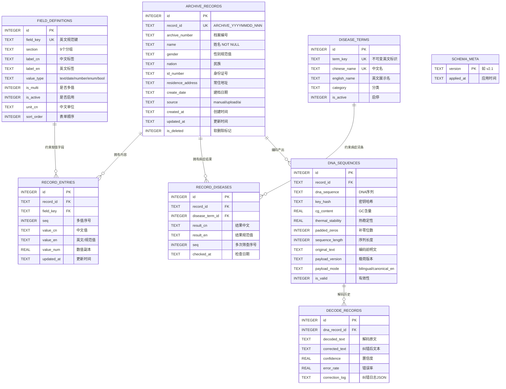

# E-R 图与数据模型说明

> 数据库：SQLite（medical_archive.db）　|　版本：v2.1　|　共 8 张表 + 1 张迁移暂存表

---

## 1. 实体总览

| 实体（表） | 中文名 | 职责 |
|---|---|---|
| schema_meta | 结构版本表 | 记录库结构版本号，支撑增量迁移 |
| archive_records | 档案主表 | 儿童健康档案的身份标识与状态（软删除） |
| field_definitions | 字段字典 | 全部业务字段的唯一登记处（真名 + 双语标签） |
| record_entries | 档案内容键值表 | 存放 53 个业务字段的具体取值（E-R 核心枢纽） |
| record_diseases | 病症结果表 | 存放每条档案的病症筛查结果 |
| disease_terms | 病症词典 | 236 条标准病症词条（中英文 + 不可变标识） |
| dna_sequences | DNA 序列表 | DNA 编码结果（序列、GC 含量、热稳定性） |
| decode_records | 解码记录表 | DNA 解码历史与纠错日志 |

---

## 2. E-R 图

### 2.1 Mermaid 版（可在支持 Mermaid 的工具中直接渲染）



### 2.2 文本版（任何环境可读）

```
schema_meta (结构版本，独立)

archive_records (档案主表)
   │ record_id (1)
   ├──< record_entries  (N) ── >── field_definitions  (字段字典，约束 field_key)
   ├──< record_diseases (N) ── >── disease_terms      (病症词典，约束 disease_term_id)
   └──< dna_sequences   (N) ──<── decode_records      (解码历史，FK=dna_sequences.id)
```

---

## 3. 联系（Relationship）文字说明

### R1　档案 — 内容条目（1 : N）

- 一条档案（`archive_records`）拥有 0～N 条内容条目（`record_entries`）；每条内容条目**必须且只能**属于一条档案。
- 联系通过 `record_entries.record_id` 外键实现，`ON DELETE CASCADE`：物理删除档案时级联清理条目。
- 附加约束：`UNIQUE(record_id, field_key, seq)` —— 同一档案的同一字段在同一序号下只有一行，多值字段靠 `seq` 递增表达"多条"。
- `field_key` 同时外键指向 `field_definitions`：**字典里没登记的字段名，数据库层面直接拒绝写入**（R1 规则的物理实现）。

### R2　档案 — 病症结果（1 : N）

- 一条档案有 0～N 条病症筛查结果；每条结果对应词典中恰好 1 个词条。
- `record_diseases.record_id` → `archive_records`（CASCADE）；`record_diseases.disease_term_id` → `disease_terms.id`。
- 附加约束：`UNIQUE(record_id, disease_term_id, seq)` 支持同一病症的多次筛查（如新生儿听力复查）。

### R3　词条 — 结果（1 : N）

- 一个词条（`disease_terms`）可出现在 N 条档案的结果中；词条 236 条全局共享。
- 词条名称不属于某条档案，统一放词典：升级、改名、停用只改一处。

### R4　档案 — DNA 序列（1 : N）

- 一条档案可经历多次编码，产生多条 DNA 序列记录；历史序列置 `is_valid=0` 而非删除，保留完整编码轨迹。
- `dna_sequences.record_id` → `archive_records.record_id`，且**不设 `ON DELETE CASCADE`**：物理删除档案会被外键拒绝，正常流程只允许档案级软删除；确需销毁时按 05 §5 的依赖顺序显式清理（先解码记录、再 DNA 序列、最后档案）。

### R5　DNA 序列 — 解码记录（1 : N）

- 一条 DNA 序列可被多次解码（不同纠错策略/密钥），产生多条解码记录。
- `decode_records.dna_record_id` → `dna_sequences.id`，构成"编码—解码"完整审计链。

### R6　字段字典 — 内容条目（1 : N，引用完整性）

- 字段字典是全局静态实体（60 条），不与任何单一档案绑定；它通过外键约束所有内容条目的字段名合法性。
- 字典停用（`is_active=0`）不影响历史条目读取，只阻止新写入。

---

## 4. 设计要点说明

1. **身份与内容分离**：列表、搜索、排序要用的 7 个身份字段保留物理列（走列最快）；其余 53 个字段进键值表，**新增字段不改表结构**，只往字典加一行。
2. **弱实体的强约束**：`record_entries` 看似弱实体，但通过双外键 + 唯一约束，实现了"字典驱动"的数据质量防护——拼写漂移在写入时即被拦截。
3. **档案层软删除、内容层物理覆盖**：`archive_records.is_deleted` 满足医疗档案审计要求；内容条目不做软删，避免与唯一约束冲突（删后重加撞槽位问题）。
4. **编码—解码闭环**：`dna_sequences` 与 `decode_records` 通过 `payload_version`、`correction_log` 字段实现载荷版本与纠错过程全程可追溯。
