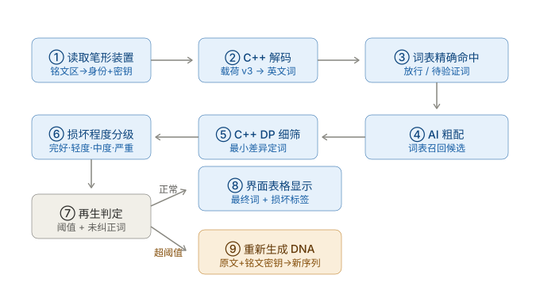

# 解码纠错与 DNA 再生设计：AI 粗配 + C++ DP 细筛

> 归属：算法模块　|　上级依据：`docs/main/api_contract.md` §7.4/§8.8、`docs/modules/algorithm.md` §6/§8、`docs/modules/payload_v3_规范.md`
> 本文定义「读取长期保存的 DNA 时，如何纠错、如何量化损坏程度、何时重新生成 DNA」这一完整闭环。

---

## 1. 定位与目标

**定位：这是项目严谨性的核心环节，不是可选装饰。**

DNA 作为长期存储介质，突变是固有风险——序列在保存期间会发生碱基替换、缺失、插入。任何声称能做 DNA 长期存储的系统，都必须正面回答“读取时怎么发现错误、怎么纠正、坏了怎么办”。本系统用下面的闭环回答：

```
编码入库 → 长期保存（可能突变）→ 读取解码 → 纠错 → 损坏程度显示
                                              ↓ 达阈值
                                    重新生成 DNA，替换受损序列 → 数据完整性维持
```

**目标**：
1. 把突变导致的错误 `option_key` 还原成词表里的正确词；
2. 量化本次读取的损坏程度，在界面上显示，让用户看得见风险；
3. 损坏到一定程度时，用库中保存的原文**重新生成一段健康 DNA**，替换受损序列，防止下一次读取时数据彻底丢失。

**与无损往返的关系**：编码器/解码器本身是无损的（实测 324 字符载荷往返逐字一致）。突变发生在**保存期间**，不是编解码环节。所以这套机制不是因为编解码有 bug，而是因为存储介质本身不可靠——这正是它在项目里不可省略的理由。

**载体与铭文（本系统的物理设定）**：档案分三种载体——`铭文`（刻在笔形存储装置上，找“是谁”**并存密钥**）／`库`（本地 SQLite，不进 DNA）／`DNA`（进序列，冷归档）。定位到某个人的存储装置后，读取其**铭文雕刻区**即可获得身份信息与解码密钥，无需查库、无需反推。这是步骤②和 DNA 再生时密钥的统一来源。

---

## 2. 完整流程（对应原理手绘图 + 再生闭环）



| 阶段 | 执行方 | 输入 | 输出 | 说明 |
|---|---|---|---|---|
| ① 读取 DNA 序列 | Python | `dna_sequences.dna_sequence` 或界面输入 | 碱基串 | 来自 v4.1 库 |
| ② 结合铭文解码 | C++ `dna_decoder.exe` | 碱基串 + 密钥 | ASCII 文本（载荷 v3 JSON） | **解码器内部固定三步顺序**（`main()` 源码）：①`remove()` 剔除 X...Y 填充片段（残留标记在碱基映射时自动忽略，见 §6.5）→ ②`jiemi_num()` 密钥展开成位流逐位 XOR → ③`fuyuan()` 位流按 8 位还原 ASCII。**密钥来自笔形存储装置的铭文雕刻区**：定位到该人的存储装置后，读取铭文区时顺带读出密钥，无需查库、无需反推 |
| ③ 取病症英文单词 | Python | 载荷 JSON 的 `ans` 字段 | `option_key` 数组 | 载荷 v3 中已是 `section_key.field_key -> [option_key]` |
| ④ 分词 | Python | `option_key` 数组 | token 列表 | 若 ③ 已结构化，此步退化为直接遍历 |
| ⑤ 词表精确命中 | Python + SQLite | token + `options.option_key` | 「原本词」（直接通过）+「待验证词」 | 命中即放行；未进词表 → 待验证 |
| ⑥ AI 粗配 | qwen2.5 + 数据库 | 待验证词 + 封闭词表 | 每词 3–10 个候选 | **只召回候选，不生成答案**；候选必须在白名单内 |
| ⑦ C++ DP 细筛 | `dna_match.exe` | 待验证词 + 候选列表 | 差异最小的最终词 + 编辑距离 | 确定性判定，可复现 |
| ⑧ 损坏程度计算 | Python | 突变碱基数、纠错词数、未纠正词数 | 损坏率 + 分级 | 见 §5.3 |
| ⑨ 界面显示 | Python + Flet | 最终词 + 损坏程度 | 表格 + 损坏提示 | **桌面软件界面表格，不是 Web 在线表格** |
| ⑩ 再生判定 | Python | 损坏程度 + 阈值 | 是否重新生成 DNA | 见 §5.4 |
| ⑪ 重新生成 DNA | Python + C++ encoder | `dna_sequences.original_text` + 密钥 | 新碱基串 | 旧序列置 `is_valid=0`，插入新行 |

**流程要点**：⑤ 把大部分词直接放行，只有未命中的少数词才进 ⑥⑦。这是原图「小数量待验证」的含义——AI 和 DP 只处理少数可疑词，成本和延迟都可控。

---

## 3. 与现有纠错设计的关系

`algorithm.md` §8 的流程是：解码 → 相似档案检索 → 损坏分析 → **AI 直接推理出正确文本** → 整合。两者差别：

| 维度 | §8 原方案 | 本文方案 |
|---|---|---|
| AI 的角色 | 生成答案（直接猜正确词） | 召回候选（从词表里挑几个） |
| 判定方式 | AI 输出即结果 | C++ DP 计算最小差异后判定 |
| 可复现性 | 低——同输入多次结果可能不同 | 高——DP 是确定性算法 |
| 编造风险 | 会生成词表里没有的词 | 候选被白名单锁死，无法编造 |
| 损坏程度 | 未量化 | 单独计算分级显示，并驱动 DNA 再生 |
| 延迟 | 一次大模型推理，秒级 | AI 一次召回 + DP 毫秒级判定 |

**以本文方案为主链路**。`algorithm.md` §8 保留为对照或兜底（词表缺失、DP 无法工作时）。

---

## 4. 硬约束（实现时必须遵守）

| # | 约束 | 原因 |
|---|---|---|
| 1 | **候选必须来自 `options.option_key` 封闭白名单**，超出即丢弃 | 防止 AI 编造不存在的词，结果才可落库 |
| 2 | **两边 token 必须按同一全序排序**：`sections.sort_order` → `fields.sort_order` → `option_key` 字典序 | 顺序不固定会让距离虚高；实测不排序时 30% 的组合失真 |
| 3 | **替换代价 = 1**，不能设 2 | 设 2 时编辑距离退化为集合对称差（3000/3000 组验证），DP 变成多余 |
| 4 | **token 全小写 ASCII、无空格** | C++ 侧 `std::string` 直接逐字节比较，避开中文 UTF-8 切分 |
| 5 | 每条 token ≤ 64 字节，单次输入 ≤ 512 字节 | 防御异常输入导致 DP 矩阵爆炸 |
| 6 | 桌面单机软件，界面表格用 Flet 控件实现 | 不存在也无需 Web 在线表格 |
| 7 | **重新生成 DNA 必须用库中的 `original_text`，不能用本次解码文本** | 解码文本可能已损坏；原文才是可信的数据源 |
| 8 | 旧序列不物理删除，置 `is_valid=0` 后插入新行 | 保留历史可追溯，符合审计要求 |
| 9 | **解码器报 Error 或载荷 `parse()` 失败 → 跳过词表纠错，直接判「严重」档触发 DNA 再生** | X/Y 哨兵被突变可致位流相位错位（静默损坏，实测见 §6.5），词级纠错救不了乱码 |

---

## 5. 接口约定

### 5.1 C++ `dna_match.exe`（新增，不改动 encoder/decoder 协议）

stdin 两段，先目标词，后候选。**格式约定：目标词与每个候选各占一行；目标词当前仅支持单个（`T 1`，纠错场景）**，多 token 序列比对（检索场景）为后续扩展：

```
T 1
fevgr
N 5
fever
fevbr
hemoglobin
fever2
cough
```

stdout：候选下标 + 编辑距离 + 相似度，按距离升序：

```
0 1 0.800
3 2 0.600
1 2 0.600
4 5 0.167
2 6 0.143
```

相似度定义：`score = 1 - dist / max(len(target), len(candidate))`。

### 5.2 Python `similarity.py`（新增，保留契约签名）

- `find_similar_records(text, threshold=0.7, limit=5)` —— 签名不变，内部换成「AI 粗配 → 调 `dna_match.exe` → 回填」。现有 `data_store.py` 实现只比姓名，是占位实现，需重写。
- `find_similar_dna_sequences(dna_sequence, threshold=0.8, limit=10)` —— 签名不变。注意此函数按 DNA 序列比对，受 `srand(time(0))` 不可复现影响，**不能用于找相似档案**，只可用于同序列完整性校验。

### 5.3 损坏程度计算与显示

三个独立指标，不要混成一个：

| 指标 | 定义 | 数据落点 |
|---|---|---|
| 碱基突变率 | 突变碱基数 / 序列总长度 | `decode_records.error_rate` |
| 词纠错率 | 被 DP 纠正的词数 / 总词数 | `decode_records.correction_log`（JSON） |
| 未纠正词数 | 超出 DP 纠错上限、无法还原的词 | `decode_records.confidence`（低置信标记） |

分级建议（阈值可调，写进 config）：

| 级别 | 条件 | 界面显示 |
|---|---|---|
| 完好 | 突变率 < 1% 且未纠正词 = 0 | 绿色标签「数据完好」 |
| 轻度 | 突变率 1–5%，全部词可纠正 | 黄色「已纠错 N 处，数据可用」 |
| 中度 | 突变率 5–15%，或有个别未纠正词 | 橙色「建议重新生成 DNA」 |
| 严重 | 突变率 > 15%，或存在关键字段未纠正 | 红色「数据风险，需重新生成」 |

界面上除表格外，建议放一个损坏程度进度条 + 上述标签，让“DNA 会突变、我们在监控”这件事可视化——这是项目叙事的关键展示点。

### 5.4 重新生成 DNA 的触发

| 触发条件 | 动作 |
|---|---|
| 损坏级别 = 严重 | 自动重新生成，替换旧序列 |
| 损坏级别 = 中度 | 弹窗询问用户，确认后重新生成 |
| 存在未纠正词（任何级别） | 必定重新生成——词都还原不了，本次数据不可信 |
| 解码器报 Error，或载荷 `parse()` 失败 | 必定重新生成（直接判严重档，跳过纠错）——位流相位错位或 JSON 结构破坏，词表救不回 |

重新生成步骤：

1. 从 `dna_sequences` 取同一 `record_id` 的 `original_text`（可信原文）；
2. 密钥从**笔形装置的铭文雕刻区**读取——定位到该人的存储装置、读取铭文区时一并取得（与 §2 步骤②同源）；
3. 调 `dna_encoder.exe(original_text, key)` 生成新碱基串；
4. 校验新序列 CG 含量 / 热稳定性达标；
5. 旧行 `is_valid=0`，插入新行（`payload_version`、`payload_mode` 保持一致）；
6. 界面提示「已重新生成 DNA，数据完整性恢复」。

**密钥来源已闭环**：`key_hash` 是单向哈希、无法反推，但不需要反推——密钥本就刻在笔形装置的铭文区里，读取装置时自然获得。这与项目「载体三分」的设定一致：铭文（物理刻，找“是谁”+ 存密钥）／库（本地 SQLite）／DNA（进序列，冷归档）。

---

## 6. 实现选项

### 6.1 AI 粗配（⑥）的四种做法

| 方案 | 做法 | 依赖 | 优点 | 代价 |
|---|---|---|---|---|
| **A. 抽取 + SQL 精确查**（推荐） | qwen2.5 把待验证词映射成标准 `option_key`，再在 `options` 表精确查 | 已有 qwen | 结果可解释、零新增依赖、白名单天然满足 | 模型偶发编造，需白名单校验兜底 |
| B. 向量召回 | `ollama pull nomic-embed-text`，词表向量化，余弦 Top-K | 新模型 + 向量列 | 语义泛化最好（`high fever`→`fever`） | 要灌向量、多一个模型、延迟更高 |
| C. 字面模糊匹配 | `rapidfuzz`/`fuzzywuzzy` 对词表算 `token_set_ratio` | 已有依赖 | 零 AI、完全可复现、毫秒级 | 同义词漏（`high fever` 匹配不到 `fever`） |
| D. AI 直接给候选列表 | 把词表塞进 prompt 让模型挑 | 已有 qwen | 实现最快 | 词表大时 prompt 超限；不可控 |

**A 为主、C 为兜底**：AI 可用时走 A，Ollama 未启动就退化成 C，演示不会卡住。B 作为后续增强，词表灌满后再考虑。

### 6.2 DP 细筛（⑦）的四种做法

| 方案 | 做法 | 适用 |
|---|---|---|
| **标准 Levenshtein**（推荐） | 替换/插入/删除代价均为 1 | 通用、最稳，约 40 行核心代码 |
| Damerau-Levenshtein | 增加相邻字母交换（代价 1） | 纠正 `fevre`→`fever` 这类顺序错误，纠错场景更准 |
| 加权编辑距离 | 按字段重要性给替换赋不同代价 | 主诉词错代价比生活习惯词高 |
| 键盘距离加权 | 按 QWERTY 相邻键赋低代价 | 本项目噪声来自碱基突变而非键盘，意义有限 |

**标准 Levenshtein 先落地**，再视突变类型决定要不要升 Damerau。

### 6.3 判定策略：什么时候采纳候选

| 策略 | 规则 | 风险 |
|---|---|---|
| **阈值 + 次小差距**（推荐） | 最小距离 ≤ 2 且比次小至少小 1 才采纳，否则保留原词并标记「未纠正」 | 稳，不会把对词改错 |
| 仅阈值 | 最小距离 ≤ 阈值就采纳 | 两个候选并列时随机选一个 |
| 总是采纳最小 | 不做任何门槛 | 危险，会把本来正确的词改坏 |

超出纠正上限的词标记「未纠正」，直接触发 §5.4 的重新生成，不硬猜。

### 6.4 突变模拟（用于演示与测试）

真实场景中突变来自长期保存；演示时需要可复现的模拟方式：

| 方式 | 说明 | 用途 |
|---|---|---|
| 碱基替换注入 | 随机把序列中若干碱基换成另一个 | 最可控，演示首选；可精确控制突变率档位 |
| 片段删除/插入 | 删掉或插入一小段碱基 | 测试较严重损坏与再生触发 |
| 真实长期保存 | 序列放置一段时间后读取 | 不可控、耗时，不作演示手段 |

注意：注入突变后，码表里的 `srand(time(0))` 随机填充片段本身也会造成序列差异，测试时要用**同一条原始序列的基线副本**做对照，不要把随机填充误判成突变。

### 6.5 X/Y 填充标记与哨兵突变（2026-11-28 实测）

编码器的 GC/AT 填充片段以人工碱基包裹：**`X` 开头、`Y` 结尾，中间是随机 CG/AT**（`DNA_encoder.cpp` 的 `add()`，注释原文「开头X结尾Y，用人工碱基做标记」）。解码器 `remove()` 成对定位 X/Y 并删除中间填充，残留标记在 `order_to_num()` 映射时被自动忽略（只映射 A/T/C/G）——**「剔除填充再映射」这一步解码器已内置，无需调用方处理**。

用 384 碱基真实编码产物实测四种场景：

| 场景 | 注入方式 | 结果 |
|---|---|---|
| 完好填充 | 插入 `XCGY` | ✅ 完整还原——remove() 正常剔除 |
| 填充内部突变 | `XCGY`→`XAGY` | ✅ **仍完整还原**——填充内容随突变无影响，只要哨兵在就整体删除，**天然抗突变**（答辩加分点） |
| 哨兵丢失 | `XCGY`→`ATAT` | ⚠ **不报错但解出乱码**——填充字节混入位流导致相位错位，属**静默损坏**，最危险 |
| X 哨兵突变 | `XCGY`→`ACGY` | ✅ X/Y 数量不配对 → 解码器报 Error，安全失败 |

**由此新增的硬约束（并入 §5.3 / §5.4）**：

9. **解码器报 Error，或解出文本无法通过载荷 `parse()` 校验 → 不进词表纠错，直接判「严重」档触发 DNA 再生。** 词级纠错只能救「个别词损坏」；位流相位错位或 JSON 结构破坏时，纠错模块收到的是乱码词，词表救不回来，硬猜只会污染数据。

---

## 7. 前置依赖与当前状态

| 项 | 现状 | 影响 |
|---|---|---|
| `options` 表 | **0 行** | 白名单和词表都是空的，AI 粗配现在跑不起来；必须先灌选项 |
| `icd_codes` 表 | 35,867 行（仅 ICD-10） | 可供 `disease_category` 一类字段派生词 |
| Ollama 服务 | 已安装但 `localhost:11434` 无响应 | 用前需 `ollama serve`，并确认 `qwen2.5:7b-instruct` 已 pull |
| `dna_decoder.exe` | 已删除 `system("pause")` 并重编译 | stdout 干净，可直接解析 |
| `decode_records` 表 | 已有 `error_rate` / `confidence` / `correction_log` 列 | 损坏程度可直接落库，无需改表 |
| `dna_sequences` 表 | 已有 `original_text` / `is_valid` 列 | 支持“用原文重生成 + 旧序列置无效”，无需改表 |
| `dna_match.exe` | **待实现** | 算法负责人的主任务 |
| `similarity.py` | **待实现** | 与 `dna_match.exe` 配套 |
| 密钥来源 | ✅ 已明确：笔形装置铭文雕刻区 | 读取装置铭文时顺带获得，用于解码与 DNA 再生；不需从 `key_hash` 反推 |

---

## 8. 验收标准

1. 给 `dna_match.exe` 喂 `fevgr` + 5 个候选，输出首行为 `fever` 且 `dist=1`。
2. 同一输入连续跑 10 次，输出逐字节一致（确定性）。
3. AI 粗配注入词表外的词（如 `zzzznotaword`），被白名单拦截，不进入 DP。
4. 词表内精确命中的词不进 DP，直接放行。
5. 注入不同档位的碱基突变，界面分别显示「完好 / 轻度 / 中度 / 严重」四级标签。
6. 严重档位或存在未纠正词时，自动重新生成 DNA：旧行 `is_valid=0`，出现新行，新序列解码后与 `original_text` 一致。
7. 界面表格显示最终词，且能在 `decode_records.corrected_text` / `error_rate` / `correction_log` 查到落库记录。
8. 注入 X/Y 哨兵突变（如 `XCGY`→`ATAT`）：系统不进入词表纠错，直接判「严重」档并触发 DNA 再生（对应硬约束 9 / §6.5）。
